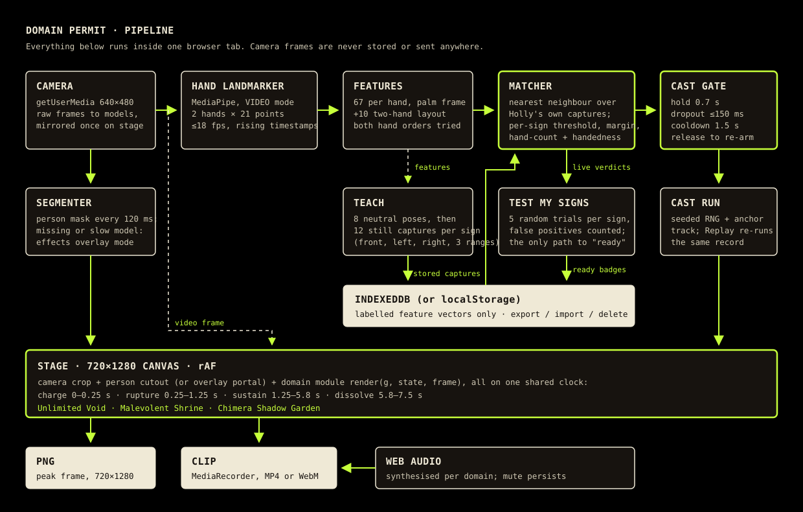

# Domain Permit

Teach three Jujutsu Kaisen domain hand signs to your webcam, then hold one for 0.7 s and that domain takes over the screen. Everything runs in the browser.

Made by Holly · IG [@Hollynst](https://instagram.com/hollynst)

Not affiliated with Gege Akutami, Shueisha, MAPPA or TOHO. Every drawing, animation and sound in it is drawn in code in this repo.



## Run it

Needs Node 20.19 or newer.

```bash
npm install
npm run dev
```

Then open http://localhost:5173 and press Start camera.

The camera only works on `localhost` or HTTPS, so opening `index.html` from your file manager will not work.

```bash
npm run build     # production build into dist/
npm run preview   # serve dist/ at http://localhost:4173
npm test          # unit tests
```

## How to use it

1. Press **Teach this sign** on a card. It starts the camera, asks for eight neutral poses the first time, then takes twelve captures of the sign from different angles.
2. Press **Test my signs**. Five tries per sign. A sign gets the green READY badge at 4/5 with no mix-ups.
3. Hold a sign for 0.7 s. The domain runs for 7.5 s, then you can save a PNG, record a clip or replay it.

**Preview effects (simulation)** plays the animations on a stand-in figure without the camera.

Keys: `M` mute, `E` effects quality, `R` record, `1`–`3` preview a domain, `Esc` back.

## The three signs

| Character | Domain | Hands | Sign |
|---|---|---|---|
| Gojo | Unlimited Void | 1 | Index finger up, middle finger hooked over it |
| Sukuna | Malevolent Shrine | 2 | Middle and ring fingers raised into a peak, palms a finger apart |
| Megumi | Chimera Shadow Garden | 2 | Fingertips interlaced, thumbs up, palms ~5 cm apart |

They come from published write-ups of the real signs, adjusted so the camera can see both hands. Each card has the full steps and a link to the official episode page.

## Privacy

Camera frames never leave the tab and are never saved. The only thing stored is the numbers describing your hand shapes, in IndexedDB, which you can export or delete from the **Training data** dialog. There is no account and nothing is uploaded. No analytics, and the microphone is never touched.

## How it works

MediaPipe finds 21 points on each hand. Each capture becomes a feature vector (joint angles and distances, scale- and rotation-normalised), and a nearest-neighbour matcher compares live hands against what you taught, plus the eight neutral poses so it knows what is *not* a sign. A second model cuts you out of the frame so the domain can sit behind you; if it can't load, the effects draw over the camera instead.

```
src/core/       features, matcher, gate, capture, storage
src/domains/    one module per domain animation
src/render/     stage, geometry, stand-in figure
src/media/      camera, tracker, segmentation, audio, recorder
src/ui/         panels, cards, header
src/handmodel/  procedural hand used by tests and the card drawings
tests/          unit tests and the browser test runner
```

`npm run fetch-models` downloads the MediaPipe models into `public/models/` so the app needs no network at all.

## Particles

Every cast also runs a live particle field on top: a few hundred motes rendered with WebGL through three.js and an UnrealBloom pass, so overlapping motes burn out to white. Each domain has its own field: the void bursts outward from your hands, the shrine comes up in embers, and the garden just swirls. It follows the cast clock and the midpoint between your hands, and the stage skips it entirely if WebGL is unavailable. three.js is loaded only once a cast needs it, so it stays out of the first page load.

## Domain backgrounds

Each domain draws itself in code, and each also has a pre-rendered backdrop in `public/domains/`. When one loads, it replaces the painted sky; the hands, charge, person cutout, slashes and titles still draw live on top. If a file is missing the domain falls back to drawing its own world, so the app works either way.

The backdrops are built with [Remotion](https://remotion.dev) in `remotion/`, where blur stacks and hundreds of layers cost nothing because it renders offline:

```bash
cd remotion
npm install
npx remotion studio                 # live preview
node render-all.mjs                 # renders into ../public/domains/
```

Rendering needs a Chrome: `CHROME_PATH=/path/to/chrome node render-all.mjs`.

## Rough edges

Unit tests and the browser runner cover the pipeline, but they drive it with
photos and synthetic hands, not a face in front of a webcam. Things I know are
still open:

- Chromium is the only browser it has actually run in. Firefox and Safari
  should work, but recording is the risky part: the container falls out of
  `MediaRecorder.isTypeSupported`, so Firefox will hand you a WebM instead of
  the MP4 Chromium gives you.
- The GPU delegate is untested. MediaPipe is asked for GPU first and falls back
  to CPU, and CPU is the path that has had the miles.
- On a slow machine hand tracking eats the whole frame budget and the person
  cutout starves. The app notices after 4 s and switches to overlay mode, but
  the threshold is a guess. `?handFps=6` helps.
- Interlaced fingers (Megumi) and pressed palms (Sukuna) are genuinely hard for
  the tracker, which is why each card offers a camera-friendly variant.

## Credits

- Code: MIT, see [LICENSE](LICENSE).
- Jujutsu Kaisen © Gege Akutami / Shueisha, JUJUTSU KAISEN Production Committee. No anime frames, music or audio are used here.
- Hand tracking: [Google MediaPipe](https://ai.google.dev/edge/mediapipe/solutions/guide), Apache-2.0, see [NOTICE](NOTICE).
- Particles and bloom: [three.js](https://threejs.org) and its post-processing passes, MIT.
- Backgrounds rendered with [Remotion](https://remotion.dev) (free for individuals and small teams; see their licence for company use).
- Fonts: IBM Plex, Instrument Serif, Schibsted Grotesk, Caveat, Anton via Fontsource, OFL 1.1.
- Visual inspiration: the reel by @reinesana.ai. None of its media is used.
